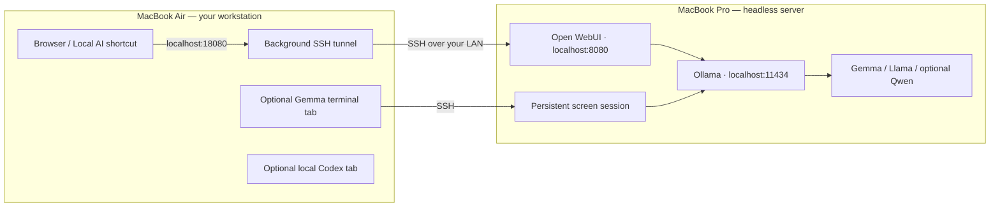

# Headless MacBook Pro AI Server — A Beginner’s How-to

**Run Gemma, Llama, and optional Qwen locally. Chat in Open WebUI from your MacBook Air.**

**Release: `v0.1.0-beta.1` · Verified baseline: October 20, 2026**

Give a spare MacBook Pro a job: run local AI models while another Mac provides the keyboard and browser. This guide starts with a working M1 MacBook Pro with 8 GB memory and builds toward a setup you can use without keeping Terminal open.

**Beginner expectation:** the initial installation uses a few Terminal commands. After setup, everyday chat uses a browser or the **Local AI** desktop shortcut. Download the software and models while online; then use them without internet access while keeping the two Macs connected to the same local network.

## What you will build

“Headless” means you operate the Pro remotely. It does **not** require shutting its lid. Start with the Pro plugged in, its lid open, and its display allowed to turn off.

## Start here

Follow these in order. Every command is labeled for the Mac where you run it.

1. **[Prepare the Pro and install local AI](docs/01-server.md)** — Ollama, models, Open WebUI, and background services.
2. **[Connect from the Air](docs/02-connect-from-air.md)** — SSH keys, the browser connection, and persistent terminal chat.
3. **[Use Open WebUI without Terminal, then go offline](docs/03-offline-webui.md)** — first account, model selection, downloads, and an offline acceptance test.
4. **[Save startup tabs and manage power](docs/04-startup-and-power.md)** — optional Air Codex + Pro Gemma tabs; screen-off behavior and restart limits.

See [troubleshooting](docs/troubleshooting.md). Before changing an existing installation, read the migration notes in the server guide.

## Model choices for this beta

| Model | Ollama tag | This project’s evidence |
| --- | --- | --- |
| Gemma 3, 4B | `gemma3:4b` | Installed; interactive prompt and persistent session verified |
| Llama 3.2, 3B | `llama3.2:3b` | Installed; loaded on the GPU during inspection |
| Qwen 3, 4B — optional | `qwen3:4b` | Documented option; not installed or benchmarked on the baseline Pro |

Start with one model at a time on an 8 GB Mac. Download size is not the same as working memory. Longer conversations and larger context settings can increase memory pressure. [Model sources and licenses](docs/models-and-licenses.md)

## What “beta” means here

The original machine setup has been exercised, including SSH reconnection and a display-off check. The portable helpers in this repository package those techniques for other machines; see the [test record](docs/tested-configuration.md) for exactly what was and was not tested.

Never publish SSH keys, passwords, chat databases, or personal documents.

## Included tools

| File | Purpose |
| --- | --- |
| [`scripts/install-services.py`](scripts/install-services.py) | Preview or install per-user server services or the Air’s background browser tunnel |
| [`scripts/pro-chat`](scripts/pro-chat) | Reconnect to a persistent local-model terminal session |
| [`scripts/pro-webui`](scripts/pro-webui) | Run a temporary foreground browser tunnel when you do not want a login service |

The installer previews changes by default. `--apply` saves files; `--load` starts them. It does not install packages, change SSH keys, or change global power settings. Models, chats, and credentials are stored outside this repository.

## License and independence

Our original guide and scripts are open source under the [MIT license](LICENSE). Model weights and third-party applications retain their own terms. Gemma and Llama are **open-weight models with model-specific licenses**; our MIT license does not relicense them. Open WebUI has its own license and branding conditions. [Details](docs/models-and-licenses.md)

This is an independent community guide, not an official Apple, Google, Meta, Qwen, Ollama, or Open WebUI project. Contributions are welcome: [contribution guide](CONTRIBUTING.md), [changes](CHANGELOG.md).
